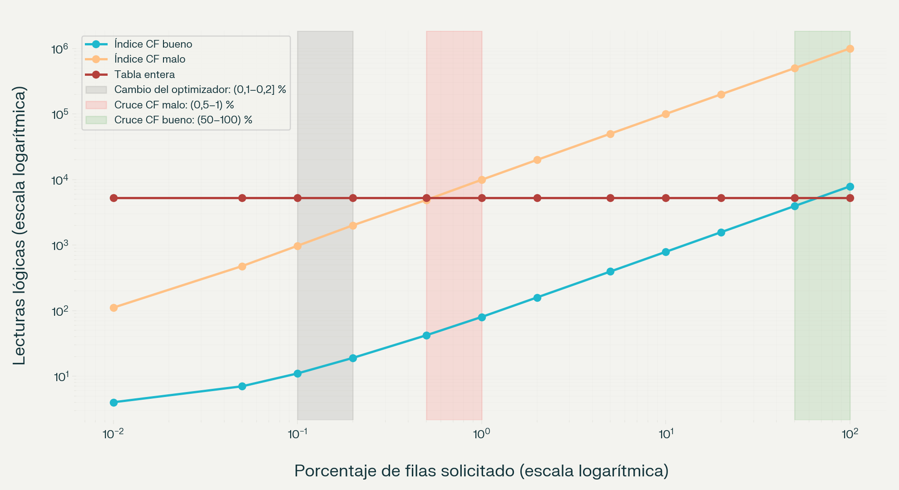

Tabla	Filas	Bloques	Bytes medios por fila	BFR mostrado
CLIENTE	100000	1517	102	66
PEDIDO	1000000	5320	32	188

# Lab 5 — Oracle DBA Workflow II

## 1. Preguntas de comprobación

## Partes A y B — Punto de partida y banco de medida

### 1. Compara el paso 6 de tu copia lab4-final con el de la copia lab3-final. ¿Qué demuestra la diferencia?

En la copia del Lab 3 había cinco datafiles de negocio fuera del volumen.
En la copia lab4-final, el paso 6 indicó:
«ninguno: el volumen contiene toda la base de datos».

Esto demuestra que la reubicación realizada en el Lab 4 dejó los
datafiles de negocio dentro del volumen respaldado.

Evidencia:
- evidencia/script/20261115T194658Z_00-backup-lab4.script.log

### 2. Calcula el factor de bloqueo (bfr) de CLIENTE y PEDIDO con sus estadísticas. ¿Por qué en PEDIDO cabe casi el triple de filas por bloque?

He calculado el bfr como NUM_ROWS / BLOCKS:

| Tabla | Filas | Bloques | Bytes medios por fila | BFR calculado |
|---|---:|---:|---:|---:|
| CLIENTE | 100000 | 1517 | 102 | 65,92 |
| PEDIDO | 1000000 | 5320 | 32 | 187,97 |

En PEDIDO caben aproximadamente 2,85 veces más filas por bloque.
Sus filas son más cortas: 32 bytes de media frente a los 102 de CLIENTE.
La proporción no es exacta porque también intervienen las cabeceras,
el espacio reservado y la ocupación real de los bloques.

Evidencia:
- evidencia/script/20261116T093923Z_01-perfil-tiendasur.script.log

#### Reto de la Parte B — Comprobación directa de las filas por bloque

Agrupé las filas de PEDIDO por el bloque obtenido mediante
DBMS_ROWID.ROWID_BLOCK_NUMBER(ROWID, 'BIGFILE').

| Medida | Resultado |
|---|---:|
| Filas totales | 1000000 |
| Bloques con filas | 5220 |
| Mínimo de filas por bloque con filas | 2 |
| Media de filas por bloque con filas | 191,57 |
| Máximo de filas por bloque | 200 |
| Bloques según las estadísticas | 5320 |
| NUM_ROWS / BLOCKS | 187,97 |

La media directa es mayor porque divide entre los 5220 bloques que
contienen filas, mientras que el cálculo estadístico divide entre 5320.
Por tanto, no utilizan el mismo conjunto de bloques como denominador.

No todos los bloques contienen las mismas filas: la longitud variable
de las filas y los bloques parcialmente llenos durante la carga pueden
producir distintas ocupaciones. El recuento muestra esa variación,
pero no demuestra la causa concreta de cada bloque.

La consulta terminó con código de salida 0.

Evidencia:
- docs/bitacora/lab5/evidencia/script/20261116T095128Z_01-bfr-pedido.script.log

### 3. ¿Por qué el banco de medida ejecuta cada sentencia dos veces y mide solo la segunda?

La primera ejecución realiza el análisis y calienta la caché.
La segunda mide la consulta en caliente, reduciendo la influencia
del trabajo inicial y permitiendo comparar alternativas en condiciones
más homogéneas.

Mi prueba prueba_pk devolvió una fila, con cuatro lecturas lógicas,
cero lecturas físicas y un tiempo de 1,1 ms. El plan utilizó
INDEX UNIQUE SCAN sobre PK_PEDIDO y TABLE ACCESS BY INDEX ROWID
sobre PEDIDO.

Evidencia:
- evidencia/script/20261116T093925Z_01-herramienta-medir.script.log

### Partes C y D — Anatomía y tipos de índice

### 4. Con tu evidencia 02: altura, número de hojas y factor de ramificación real de IX_PED_CLIENTE. ¿Qué altura tendría con mil millones de filas?

IX_PED_CLIENTE tiene altura 3, 2216 bloques de hoja y 6 bloques de rama,
con un millón de entradas y ninguna entrada borrada.

El factor de ramificación medio es:
(2216 + 6 - 1) / 6 = 370,17, aproximadamente 370 hijos por rama.

El máximo estimado por el script es 543. Usando ese máximo y sus
supuestos de capacidad y ocupación, la proyección para mil millones
de filas es de 2208969 hojas y altura 4. Buscar una fila y recuperar
una columna de la tabla requeriría aproximadamente 5 lecturas:
4 del índice y 1 de la tabla.

En la prueba real de PK_PEDIDO, la búsqueda de ID_PEDIDO e IMPORTE
necesitó 4 lecturas lógicas. Al pedir solamente ID_PEDIDO, presente
en el índice, necesitó 3 y evitó el acceso a la tabla.

### 5. En el volcado de la hoja de PK_CLIENTE, localiza una entrada y descompón el ROWID que guarda en bloque y fila. ¿Por qué no aparece el número de archivo?

La primera entrada de la hoja contiene:

    row#0: data:(6): 00 00 03 1b 00 00
    col 0; len 2: c1 02

La clave c1 02 corresponde a ID_CLIENTE = 1.
Los seis bytes de data se descomponen en:
- 00 00 03 1b: bloque 0x31B, equivalente a 795.
- 00 00: ranura 0 dentro del bloque.

La consulta de comprobación confirmó bloque 795 y ranura 0 para
el cliente 1.

No aparece el número de archivo porque es un tablespace BIGFILE:
el ROWID corto de esta entrada utiliza cuatro bytes para el bloque
y dos para la ranura; no necesita distinguir varios datafiles
dentro del tablespace.

La raíz de PK_CLIENTE tiene 186 entradas separadoras más el hijo
izquierdo kdxbrlmc: en total, 187 hijos, correspondientes a sus
187 hojas.

#### 5. En el volcado de la hoja de PK_CLIENTE, localiza una entrada y descompón el ROWID que guarda en bloque y fila. ¿Por qué no aparece el número de archivo?

Pendiente.

#### 6. Elige tres pruebas de la Parte D y explica, con las lecturas lógicas medidas, por qué un tipo de índice gana al otro.

He elegido tres comparaciones de mi evidencia 03:

| Prueba | Alternativa inicial | Alternativa final | Lecturas lógicas |
|---|---|---|---|
| Q13: búsqueda por DNI | Sin índice | Índice único UX_CLI_DNI | 1486 → 3 |
| Q7: historial del cliente | IX_PED_CLIENTE | Compuesto / cubriente | 15 → 7 → 3 |
| Q14: combinación de filtros | Sin bitmaps | Cuatro índices bitmap | 4073 → 528 |

En Q13, el plan pasó de TABLE ACCESS FULL a INDEX UNIQUE SCAN
con acceso a la tabla por ROWID. Además de acelerar la búsqueda,
el índice rechazó el DNI duplicado mediante ORA-00001.

En Q7, el índice inicial necesitaba acceder a la tabla y ordenar
las filas. El compuesto (id_cliente, fecha_pedido) eliminó el SORT
y redujo las lecturas de 15 a 7. El cubriente incluyó todas las
columnas solicitadas y evitó también acceder a la tabla: 3 lecturas.
Su coste en espacio fue de 40 MB, frente a los 18 MB de IX_PED_CLIENTE.

En Q14, el plan combinó los cuatro bitmaps mediante BITMAP AND
antes de acceder a la tabla. Las lecturas bajaron de 4073 a 528.
Esta medida corresponde al experimento de consulta; no demuestra
que sea la mejor opción para una carga con escrituras concurrentes.

El script terminó con código 0 y dejó 7 índices en TiendaSur
después de eliminar los objetos experimentales.

### Partes E y F — Agrupamiento, equilibrio y sargabilidad

### 7. ¿Por qué IX_PED_FECHA tiene un clustering factor cercano al número de bloques e IX_PED_CLIENTE cercano al de filas? ¿Lo arreglaría un REBUILD?

PEDIDO tiene 1000000 filas y 5320 bloques según las estadísticas.
IX_PED_FECHA tiene CF = 5220, mientras que IX_PED_CLIENTE tiene
CF = 999041. El cálculo directo confirmó ambos valores.

La carga dejó las filas físicamente ordenadas por fecha, por lo que
recorrer IX_PED_FECHA permite recuperar filas consecutivas del índice
en pocos bloques de tabla. Los clientes están repartidos: al recorrer
IX_PED_CLIENTE se cambia de bloque de tabla casi en cada entrada.

El CF cuenta cambios de bloque durante el recorrido ordenado,
no solamente bloques únicos: un mismo bloque puede volver a visitarse.

Un REBUILD del índice no reordena las filas de la tabla y, por tanto,
no corrige ese mal agrupamiento. Reordenar la tabla podría favorecer
el acceso por cliente, pero perjudicar el orden por fecha.

### 8. Según tu curva de la Parte E, ¿a partir de qué porcentaje deja de compensar cada índice? Compáralo con la fórmula de la Unidad 3.

El recorrido completo costó 5232 lecturas lógicas en todas las pruebas.

| Comparación | Último punto favorable al índice | Primer punto desfavorable |
|---|---|---|
| CF malo | 0,5 %: 4875 lecturas | 1 %: 9920 lecturas |
| CF bueno | 50 %: 3938 lecturas | 100 %: 7875 lecturas |

Por tanto, el cruce medido queda entre el 0,5 % y el 1 % para
el índice con CF malo, y entre el 50 % y el 100 % para el de CF bueno.
No he medido el porcentaje exacto dentro de esos intervalos.

Con bfr = 188 y suponiendo igual coste por lectura, la fórmula
predice 1/188 = 0,53 %, compatible con el intervalo del CF malo.
Si se supone c_sec/c_aleat = 1/5, la predicción baja al 0,11 %.
Esta segunda cifra es un supuesto de costes, no una latencia medida
en esta prueba.

El optimizador eligió el índice con CF malo hasta el 0,1 % y ya
eligió recorrido completo al 0,2 %. Su cambio queda entre esos
dos puntos y ocurre antes del cruce de lecturas lógicas observado.
El coste estimado por el optimizador no equivale simplemente al
número de lecturas lógicas de esta ejecución en caliente.

### 9. Explica por qué Q4b (Gonz%) usa el índice y aun así lee más bloques que un recorrido completo.

Q4b devolvió 2056 filas y realizó 2024 lecturas lógicas mediante
INDEX RANGE SCAN sobre IX_CLI_APELLIDOS y acceso a CLIENTE por ROWID.
El recorrido completo de Q4a realizó 1523 lecturas lógicas.

El prefijo Gonz% permite localizar un rango en el índice, pero después
hay que recuperar las columnas solicitadas en los bloques de la tabla.
Si esas filas están dispersas, esos accesos pueden acumular más lecturas
que un recorrido completo.

Usar un índice no garantiza menos lecturas. En esta ejecución Q4b
tardó menos, pero ese tiempo aislado no demuestra que su acceso sea
siempre mejor.

Además, Q4a y Q4b no son consultas equivalentes: %ez devolvió
18902 filas y Gonz% devolvió 2056. La comparación muestra el coste
observado de ambos planes, no una prueba de la misma consulta
ejecutada con y sin índice.

### Partes G y H — Coste de escritura y mantenimiento

#### 10. Con tu evidencia 06: bloques modificados por INSERT con 4, 9 y 5 índices. ¿Qué índices de la propuesta del compañero rechazaste y con qué dato?

Pendiente.

#### 11. Distingue, con tus gráficos de la Parte H, un índice con divisiones 50/50, uno con divisiones 90/10 y uno con patrón cola.

Pendiente.

#### 12. ¿Qué remedio elegirías para el patrón cola en producción, en horario de servicio, y por qué?

Pendiente.

### Partes I a L — SCN, control files, redo y FRA

#### 13. Con tu evidencia 08: ¿qué valores compara Oracle al abrir para decidir si hace falta recuperación?

Pendiente.

#### 14. ¿Qué protege la multiplexación del control file en el mismo volumen y qué no? ¿Cómo se haría en producción?

Pendiente.

#### 15. Explica los estados CURRENT, ACTIVE e INACTIVE con tu evidencia 10 y por qué Oracle rechaza los tres borrados del paso 4.

Pendiente.

#### 16. Describe la cadena de causas del escenario de la FRA llena, desde ORA-19815 hasta que la base deja de aceptar cambios.

Pendiente.

### Partes M a P — Undo, WAL y simulacros

#### 17. Explica, con los pasos 1 a 4 de tu evidencia 12, la frase «lectores no bloquean a escritores».

Pendiente.

#### 18. ¿Por qué un DELETE genera más undo que un INSERT? ¿Por qué el ROLLBACK también genera redo?

Pendiente.

#### 19. Con tu evidencia 13: ¿dónde está la garantía de durabilidad justo después del COMMIT? ¿Y después del checkpoint?

Pendiente.

#### 20. Simulacro A: explica roll forward y roll back con las filas 102 y 103 y las líneas del alert log.

Pendiente.

#### 21. Simulacros C y D: tu RTO y tu RPO en cada uno. ¿Por qué son tan distintos?

Pendiente.

#### 22. Clasifica cada error ORA- del bloque 5 de tu runbook: incidente real, efecto del laboratorio o ruido conocido.

Pendiente.

## 2. Retos y puntos de control

### Parte B — Filas por bloque de PEDIDO

Enunciado: calcular con DBMS_ROWID.ROWID_BLOCK_NUMBER cuántas filas
hay en los bloques de PEDIDO (mínimo, media y máximo), compararlo
con NUM_ROWS / BLOCKS y explicar por qué los bloques no contienen
todos el mismo número de filas.

Resultado:
- Filas totales: 1000000.
- Bloques con filas: 5220.
- Mínimo: 2 filas por bloque.
- Media: 191,57 filas por bloque con filas.
- Máximo: 200 filas por bloque.
- Estadísticas: NUM_ROWS = 1000000 y BLOCKS = 5320.
- BFR estadístico: 187,97.
- Código de salida: 0.

Interpretación:
La media directa utiliza solamente los 5220 bloques que contienen
filas. El cálculo estadístico utiliza 5320 bloques, por lo que su
denominador es mayor y el resultado es menor. No son exactamente
la misma medida.

La ocupación no es uniforme: influyen la longitud variable de las
filas y los bloques que quedan parcialmente llenos durante la carga.
El resultado observado es compatible con ello, aunque el recuento
por sí solo no identifica la causa concreta de cada bloque.

Evidencia: evidencia/script/<nombre-del-log-01-bfr-pedido>

### Partes C a P

### Parte C — Interpretación de los gráficos iniciales

| Índice | Hojas | Ocupación viva media | Entradas borradas | Hojas vacías |
|---|---:|---:|---:|---:|
| PK_PEDIDO | 1875 | 99,9 % | 0 | 0 |
| IX_PED_CLIENTE | 2216 | 89,7 % | 0 | 0 |

Los dos mapas son uniformes: PK_PEDIDO muestra # en todos los tramos
e IX_PED_CLIENTE muestra =. No aparece el patrón de izquierda vacía
y derecha llena que identificaría un patrón cola.

Evidencias de la ejecución:
- evidencia/script/20261116T101118Z_02-anatomia-indice.script.log
- evidencia/script/20261116T101118Z_02-grafico-PK_PEDIDO.script.log
- evidencia/script/20261116T101118Z_02-grafico-IX_PED_CLIENTE.script.log
- evidencia/config/20261116T101118Z_02-volcado-indice.trc.txt

#### Predicción y comprobación de UX_CLI_EMAIL

Con 100000 entradas, 30 bytes estimados por entrada y 7996 bytes
útiles por hoja, cabrían floor(7996 / 30) = 266 entradas por hoja.

Sin ajustar el espacio libre, se necesitarían ceil(100000 / 266)
= 376 hojas. Con un factor de ramificación máximo de 543:

h = 1 + ceil(log_543(376)) = 2.

La predicción simplificada es altura 2. Sin embargo, el diccionario
de mi ejecución ya mostró altura 3 y 501 hojas. El modelo no reproduce
necesariamente el árbol real: supone para este índice el mismo factor
de ramificación que IX_PED_CLIENTE, aunque las claves tienen diferente
tamaño y distribución.

La comprobación con ANALYZE INDEX ... VALIDATE STRUCTURE mostró:

| Medida | Resultado |
|---|---:|
| Altura | 3 |
| Bloques de hoja | 501 |
| Bloques de rama | 3 |
| Entradas | 100000 |
| Bytes medios por entrada | 35,89 |
| Ocupación | 90 % |
| Entradas borradas | 0 |

La altura medida es 3, frente a la predicción simplificada de 2.
Las entradas reales ocupan 35,89 bytes de media, no los 30 supuestos.
Además, el factor de ramificación 543 utilizado en la predicción
procedía de IX_PED_CLIENTE: no es una capacidad medida para las ramas
de UX_CLI_EMAIL. Por eso la predicción no reproduce la altura real.

El gráfico mostró 501 hojas: 500 en el tramo de ocupación 80–89 %
y una en el tramo 0–9 %. La ocupación viva media fue del 89,6 %,
sin entradas borradas ni hojas vacías.

El mapa agregado fue uniforme, con símbolos =. No muestra un patrón
cola. La hoja poco ocupada aparece en el histograma, aunque no se
distingue en el mapa porque este agrupa las hojas en 64 tramos.

En comparación, la primera hoja de PK_CLIENTE tenía 578 entradas
y solo 8 bytes libres. Ambos índices tienen 100000 entradas, pero
sus claves son distintas: PK_CLIENTE utiliza identificadores numéricos
y UX_CLI_EMAIL utiliza correos de texto. El tamaño y el orden de las
claves influyen en su estructura y ocupación.

El reto terminó con código de salida 0.

### Parte D — ¿Haría cubriente el índice de Q9?

No añadiría columnas a IX_PED_FECHA para esta consulta: recuperar
los 20 pedidos más recientes ya cuesta solo 5 lecturas lógicas,
mientras que PEDIDO ocupa 41,6 MB y cubrir todas sus columnas
exigiría mantener un índice más ancho.

El plan fue COUNT STOPKEY > VIEW > TABLE ACCESS BY INDEX ROWID
PEDIDO > INDEX FULL SCAN DESCENDING IX_PED_FECHA.
La prueba devolvió 20 filas, sin lecturas físicas, y terminó con código 0.

Esta decisión se basa en el bajo coste medido; no he creado ni medido
un índice cubriente alternativo para Q9.

### Parte E — Curva del punto de equilibrio

El índice con CF malo supera el coste del recorrido completo entre
el 0,5 % y el 1 %; el de CF bueno, entre el 50 % y el 100 %.
El optimizador cambia antes, entre el 0,1 % y el 0,2 %, porque estima
costes y no compara únicamente las lecturas lógicas medidas.
Los intervalos reflejan los puntos probados, no cruces exactos.

### Parte F — Sargabilidad: resultados medidos

| Prueba | Lecturas iniciales | Lecturas finales |
|---|---:|---:|
| Q1: función sobre EMAIL → función sobre el dato recibido | 1486 | 4 |
| Q2: aritmética sobre FECHA_PEDIDO → columna despejada | 5285 | 323 |
| Q3: código postal numérico → literal de texto | 5232 | 106 |
| Q5: OR sin índice en teléfono → ambas ramas indexadas | 1486 | 6 |
| Q5: alternativa UNION con ambas ramas indexadas | 1486 | 6 |
| Q11: EXTRACT → rango de fechas | 5232 | 5232 |

En Q3, el plan de la consulta original mostró
TO_NUMBER("CODIGO_POSTAL") = 30001: la conversión se aplicaba a la
columna. La comparación con un literal de texto permitió utilizar
el índice temporal IX_PED_CP.

Q4a (%ez) y Q4b (Gonz%) no son reescrituras equivalentes:
buscan conjuntos distintos. Q4b permitió un rango por índice,
pero acumuló 2024 lecturas, frente a las 1523 del recorrido de Q4a.

En Q5, tanto la solución OR con ambas ramas indexadas como UNION
necesitaron 6 lecturas. No atribuyo la mejora de UNION únicamente
a la reescritura: en esa prueba ya existía el índice de teléfono.

Q11 mantuvo TABLE ACCESS FULL y 5232 lecturas en ambas versiones.
Una condición sargable permite considerar el índice, pero no obliga
a elegirlo cuando se solicita una parte grande de la tabla.

La ejecución terminó con código 0 y dejó los 7 índices originales.

## 3. Simulacro de examen S1–S26

Para cada pregunta: letra o letras elegidas, una frase de justificación
y la Parte del laboratorio que lo demuestra.

| Pregunta | Respuesta | Justificación y Parte |
|---|---|---|
| S1 | Pendiente | |
| S2 | Pendiente | |
| S3 | Pendiente | |
| S4 | Pendiente | |
| S5 | Pendiente | |
| S6 | Pendiente | |
| S7 | Pendiente | |
| S8 | Pendiente | |
| S9 | Pendiente | |
| S10 | Pendiente | |
| S11 | Pendiente | |
| S12 | Pendiente | |
| S13 | Pendiente | |
| S14 | Pendiente | |
| S15 | Pendiente | |
| S16 | Pendiente | |
| S17 | Pendiente | |
| S18 | Pendiente | |
| S19 | Pendiente | |
| S20 | Pendiente | |
| S21 | Pendiente | |
| S22 | Pendiente | |
| S23 | Pendiente | |
| S24 | Pendiente | |
| S25 | Pendiente | |
| S26 | Pendiente | |

## 4. Simulacros — RTO, RPO y retrospectivas

| Simulacro | RTO medido | RPO real | Evidencia |
|---|---|---|---|
| A — Caída de instancia | Pendiente | Pendiente | |
| B — Pérdida de un control file | Pendiente | Pendiente | |
| C — Borrado de una tabla | Pendiente | Pendiente | |
| D — Pérdida de un datafile | Pendiente | Pendiente | |

Para cada simulacro:
- Qué ocurrió y cómo se recuperó.
- Qué me sorprendió.
- Qué cambiaría del procedimiento.

## 5. Retrospectiva — FRA llena

Pendiente de realizar la Parte L.

## 6. Verificación y cierre

Pendiente de realizar las Partes P y Q.